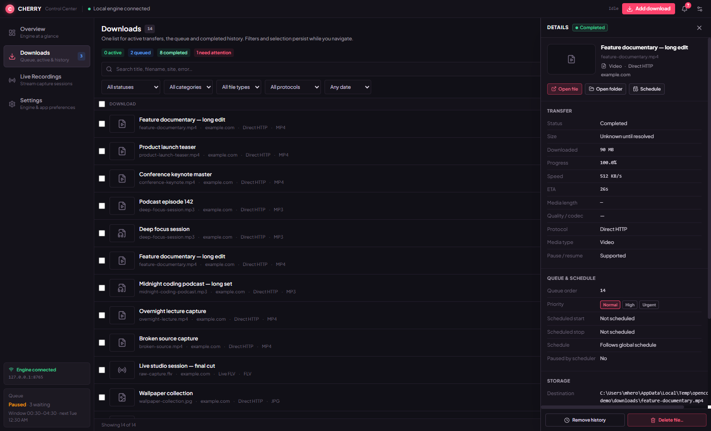
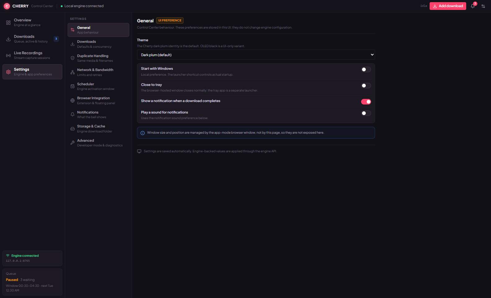

# Cherry — Download Manager

  

<b>Windows media downloader and stream capture, bundled with FFmpeg, aria2 and yt-dlp.</b>

Version 0.4.2 · Windows 10 (1809) or newer, 64-bit · Chrome, Edge, Brave, Opera or Vivaldi

Cherry detects media on web pages, resolves HLS/DASH streams, records public live streams and hands downloads to a local engine. It runs per user, needs no administrator rights, and keeps settings and downloads under folders you choose.

## Download

| File | Use | Notes |
| --- | --- | --- |
| `Cherry-0.4.2-Setup.exe` | Windows installer | The only file needed for a normal install. |
| `Cherry-0.4.2-Extension.zip` | Browser extension package | Use it to add or reload the extension manually. |

## Browser extension

Browsers do not allow an installer to add extensions silently. Cherry opens your default browser and copies its extensions address. Then:

1. Open the extensions page.
2. Turn on **Developer mode**.
3. Click **Load unpacked** and choose the folder Cherry shows.

To add the extension to another browser later, open **Settings → Browser Integration → Add to another browser**.

Chrome, Edge, Brave, Opera and Vivaldi share the same build. Firefox needs a separate port and is not supported in 0.4.2.

## Screenshots

  
  

  
  

  

## Documentation

- [Live capture and Link Grabber walkthrough](docs/live-capture-walkthrough.md)

This repository contains release documentation and licence texts only; the application is distributed as compiled release files.

## Support

Cherry is free. If you want to support development, send crypto directly on the correct network. ERC-20 and TRC-20 USDT use different addresses.

| Asset | Network | Address |
| --- | --- | --- |
| BTC | Bitcoin | `bc1p3naycr4wm6gfnw3mqj0tmaflhcy25zzv7r0vy0l4wqpwqrkhk3jsx4yaue` |
| ETH | Ethereum (ERC-20) | `0xae4f0d65fb0e24081d5ed8beca74b3489bd05d3b` |
| USDT (ERC-20) | Ethereum — same 0x address as ETH | `0xae4f0d65fb0e24081d5ed8beca74b3489bd05d3b` |
| USDT (TRC-20) | Tron — different address | `TA8PdNGQEtqkPi4je59GbLfLxFfHTRrWHD` |

The **Credits** tab in Cherry shows support addresses, extension status and diagnostics you can copy when asking for help.

## Installation

1. Download `Cherry-0.4.2-Setup.exe` and run it. No administrator rights are needed. Cherry installs per user under `%LOCALAPPDATA%\Programs\Cherry`.
2. Accept the licence when asked. Settings stay in `%LOCALAPPDATA%\Cherry`; files go to the download folder you choose in Settings.
3. On first launch Cherry opens the extension setup and offers English or Arabic. Follow the steps in [Browser extension](#browser-extension) to load the unpacked extension in your Chromium browser.
4. Start Cherry from the Start menu, the desktop shortcut or the installed `Cherry.exe`. It starts hidden in the system tray; click the Cherry tray icon to open the window.
5. Before your first download, open **Settings** and choose the download folder. Live recordings and finished files appear in **Downloads**.
6. To record a public live URL, open **Live → New recording**, press **Start recording**, then **Stop** when finished. To scan a page for links, use **Link Grabber**. Both flows are described in the [walkthrough](docs/live-capture-walkthrough.md).
7. To add the extension to another browser later, use **Settings → Browser Integration → Add to another browser**. If an older unpacked extension is still installed, reload it from the 0.4.2 release files.
8. To remove Cherry, use **Uninstall Cherry** in the Start menu or remove it from Windows Settings → Apps. Your chosen download folder is not deleted by the uninstaller.

Cherry does not ask for a login, import browser cookies or bypass paywalls, DRM or captchas. Nothing from your browser profile, history or personal files is read or packaged. Firefox is unsupported in 0.4.2.

## Licence

Cherry is proprietary freeware, copyright (c) 2026 Mohammed Kortam. See `EULA.txt` and `NOTICES.txt` for the full terms and third-party licences.

## Credits

Cherry is developed by Mohammed Kortam. It bundles these main components; the full list and licence texts are installed in the `licenses` folder next to `Cherry.exe` and are summarised in `NOTICES.txt`:

- FFmpeg 8.0.1 — GPL v3 or later
- Qt 6.12 / PySide6 — LGPL v3
- Python 3.13 — PSF licence
- yt-dlp 2026.10.21 — The Unlicense
- aria2 1.37.0 — GPL v2
- PyInstaller 6.22.3 — GPL v2 with bootloader exception

Repository licence texts: `LICENSE.GPLv2.txt`, `LICENSE.LGPLv3.txt`, `LICENSE.PSF.txt`. The **Credits** tab in the app also shows support addresses, extension status and diagnostics.
