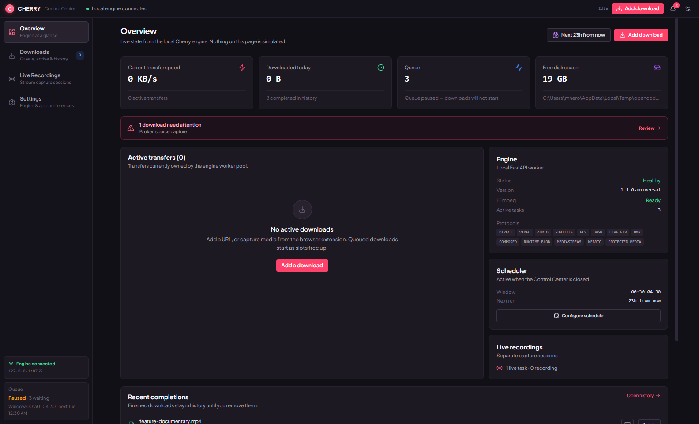
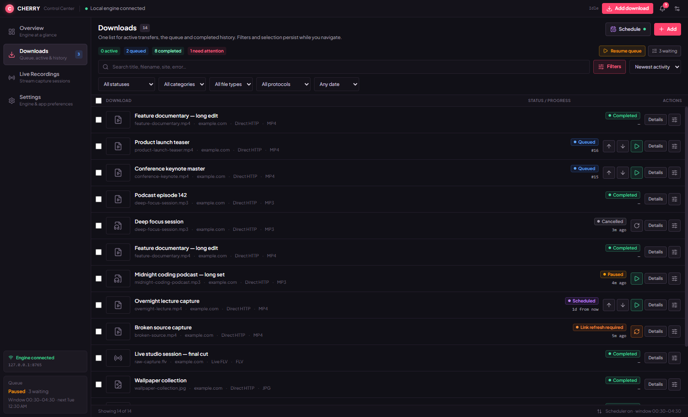
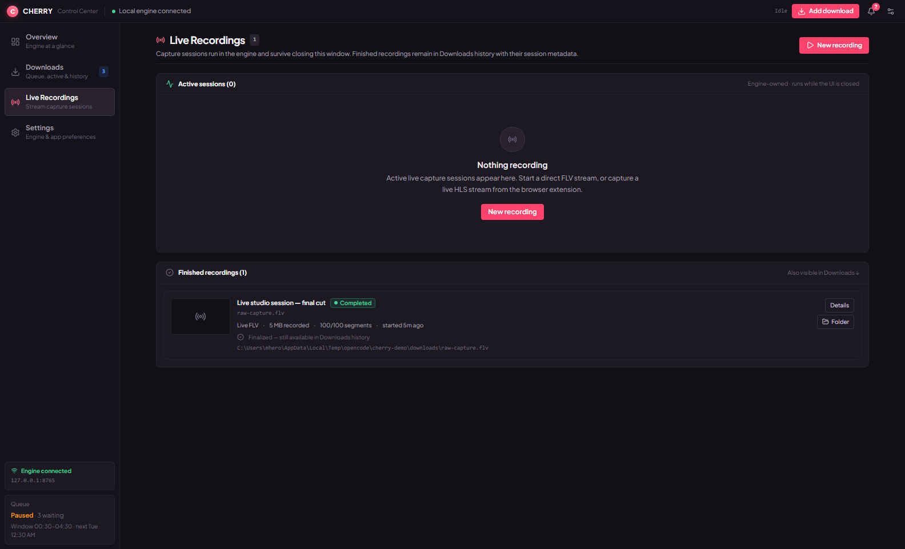

# Cherry — Download Manager

  

<b>Windows media downloader and stream capture, bundled with FFmpeg, aria2 and yt-dlp.</b>

Version 0.4.2 · Windows 10 (1809) or newer, 64-bit · Chrome, Edge, Brave, Opera or Vivaldi

Cherry detects media on web pages, resolves HLS/DASH streams, records public live streams and hands downloads to a local engine. It runs per user, needs no administrator rights, and keeps settings and downloads under folders you choose.

# 🍒 What Cherry Can Do

**Cherry is more than just a download manager. It's an all-in-one downloading workspace designed to bring different downloading tools and workflows together in one clean, powerful, and easy-to-use application.**

Whether you're downloading videos, saving entire playlists, grabbing files from websites, or managing torrents, Cherry gives you the tools to get the job done without constantly switching between applications.

## 🎬 Video & Audio Downloads

Download media from supported websites using Cherry's integrated media extraction engine, powered by yt-dlp.

- **Multiple Platforms:** Supports media extraction from platforms such as YouTube, Vimeo, SoundCloud, and Dailymotion, along with other sites supported by yt-dlp.
- **Quality Selection:** Choose from available quality options, including Best Quality, 2160p, 1440p, 1080p, 720p, 480p, 360p, or audio-only downloads.
- **Multiple Formats:** Select your preferred output format, including MP4, MKV, WebM, M4A, Opus, and MP3, depending on source availability.
- **Playlist Downloads:** Extract entire playlists and review their contents before downloading.
- **Playlist Control:** Remove individual videos, rearrange the download order, download selected videos, and choose quality settings for individual items or the entire playlist.
- **Flexible Downloads:** Review extracted media information and configure your download choices before starting.

## 📡 Live Stream Downloads

Cherry brings live-stream downloading into the same workflow as regular media downloads.

- Capture supported live streams using the available extraction capabilities.
- Handle live media sources through the media extraction workflow.
- Keep live-stream downloading alongside your other downloads instead of relying on a separate application.

*Live-stream availability and supported features depend on the source platform and extractor capabilities.*

## 🧲 Link Grabber

Found a direct download link? Cherry can take care of it.

The built-in Link Grabber is designed to handle more than just videos.

- **Any File Type:** Grab direct links to different types of files, including archives, documents, images, installers, and media.
- **Automatic Link Handling:** Add links without manually configuring every download.
- **Centralized Management:** Keep your downloads organized in one place.
- **Duplicate Handling:** Control how Cherry handles files and links that already exist.
- **Less Manual Work:** Spend less time copying links between different download tools.

## 🔎 Page Scanner

Not every download link is directly visible.

Cherry's Page Scanner helps discover downloadable resources from a webpage, making it easier to find files that would otherwise require manually inspecting page content.

- Scan webpages for discoverable download links.
- Collect multiple links from a single page.
- Review discovered links before downloading.
- Send selected links directly into Cherry's download workflow.

## 🌐 Browser Integration

Cherry can work alongside your browser to make downloading more convenient.

- Integrate with supported browsers through the Cherry browser extension.
- Send downloadable media and links to Cherry instead of handling them manually.
- Use the floating download interface for a quicker media-download workflow.
- Configure browser integration through Cherry's settings.

## 🧲 BitTorrent Support

Cherry isn't limited to direct downloads.

With integrated BitTorrent support powered by aria2, you can manage torrent downloads alongside your regular files.

- Add and manage torrent downloads.
- Keep torrent and direct downloads in one application.
- Monitor download progress from the same interface.
- Manage your downloads without needing a separate torrent client.

## ⚙️ Built-in Download Management

Cherry gives you control over how your downloads behave.

- **Download Queue:** Manage multiple downloads from one place.
- **Progress Monitoring:** Track download progress, speed, downloaded size, and estimated remaining time.
- **Pause & Resume:** Control active downloads when supported by the source.
- **Duplicate Handling:** Configure how existing files and duplicate downloads are handled.
- **Download Organization:** Choose where files are stored and configure storage preferences.
- **Network Settings:** Adjust available network and download behavior.
- **Notifications:** Stay informed about download events and completion.
- **Scheduler:** Configure scheduled download behavior.
- **Persistent Settings:** Keep your preferences between application sessions.

## 🎨 A Clean, Modern Experience

Powerful functionality doesn't have to come with a complicated interface.

Cherry is built around a modern dark interface that keeps your downloads and controls easy to access.

- A centralized Downloads interface.
- Dedicated settings for different parts of the application.
- Clear download progress and status information.
- Media thumbnails and useful file information where available.
- A focused progress window with download details and quick actions.
- A completion window with options to open the downloaded file or its containing folder.
- A floating download interface designed for quick access.

---

# 💡 Why Cherry?

There are plenty of download managers out there. So why use Cherry?

Because downloading shouldn't require a collection of separate applications.

**Cherry brings multiple downloading workflows together under one roof.**

| Instead of using... | Cherry gives you... |
|---|---|
| A video downloader | Integrated video and audio extraction |
| A playlist downloader | Playlist extraction and per-video control |
| A direct-link manager | A built-in Link Grabber |
| A webpage link extractor | Page Scanner |
| A separate torrent client | Integrated BitTorrent support |
| Separate browser workflows | Browser integration and a floating download interface |
| Multiple download tools | One centralized download manager |

### One Application. Multiple Workflows.

Cherry is designed for people who download different kinds of content and want more control without unnecessary complexity.

Whether it's a single file, a full playlist, a collection of webpage links, or a torrent, Cherry aims to make the entire process simpler.

**Less switching. Less manual work. More control.**

🍒 **One Cherry. All Your Downloads.**

## Download

Open the [Releases page](https://github.com/mhmdkrtm/cherry-download-manager/releases/latest) if the badge does not load.

| File | Use | Notes |
| --- | --- | --- |
| `Cherry-0.4.2-Setup.exe` | Windows installer | The only file needed for a normal install. |
| `Cherry-0.4.2-Extension.zip` | Browser extension package | Use it to add or reload the extension manually. |

## Browser extension

Browsers do not allow an installer to add extensions silently. Cherry opens your default browser and copies its extensions address. Then:

1. Open the extensions page.
2. Turn on **Developer mode**.
3. Click **Load unpacked** and choose the folder Cherry shows.

To add the extension to another browser later, open **Settings → Browser Integration → Add to another browser**.

Chrome, Edge, Brave, Opera and Vivaldi share the same build. Firefox needs a separate port and is not supported in 0.4.2.

## Screenshots

  
  

  
  

  

## Documentation

- [Live capture and Link Grabber walkthrough](docs/live-capture-walkthrough.md)

This repository contains release documentation and licence texts only; the application is distributed as compiled release files.

## Support

Cherry is free. If you want to support development, send crypto directly on the correct network. ERC-20 and TRC-20 USDT use different addresses.

| Asset | Network | Address |
| --- | --- | --- |
| BTC | Bitcoin | `bc1p3naycr4wm6gfnw3mqj0tmaflhcy25zzv7r0vy0l4wqpwqrkhk3jsx4yaue` |
| ETH | Ethereum (ERC-20) | `0xae4f0d65fb0e24081d5ed8beca74b3489bd05d3b` |
| USDT (ERC-20) | Ethereum — same 0x address as ETH | `0xae4f0d65fb0e24081d5ed8beca74b3489bd05d3b` |
| USDT (TRC-20) | Tron — different address | `TA8PdNGQEtqkPi4je59GbLfLxFfHTRrWHD` |

The **Credits** tab in Cherry shows support addresses, extension status and diagnostics you can copy when asking for help.

## Installation

1. Download `Cherry-0.4.2-Setup.exe` and run it. No administrator rights are needed. Cherry installs per user under `%LOCALAPPDATA%\Programs\Cherry`.
2. Accept the licence when asked. Settings stay in `%LOCALAPPDATA%\Cherry`; files go to the download folder you choose in Settings.
3. On first launch Cherry opens the extension setup and offers English or Arabic. Follow the steps in [Browser extension](#browser-extension) to load the unpacked extension in your Chromium browser.
4. Start Cherry from the Start menu, the desktop shortcut or the installed `Cherry.exe`. It starts hidden in the system tray; click the Cherry tray icon to open the window.
5. Before your first download, open **Settings** and choose the download folder. Live recordings and finished files appear in **Downloads**.
6. To record a public live URL, open **Live → New recording**, press **Start recording**, then **Stop** when finished. To scan a page for links, use **Link Grabber**. Both flows are described in the [walkthrough](docs/live-capture-walkthrough.md).
7. To add the extension to another browser later, use **Settings → Browser Integration → Add to another browser**. If an older unpacked extension is still installed, reload it from the 0.4.2 release files.
8. To remove Cherry, use **Uninstall Cherry** in the Start menu or remove it from Windows Settings → Apps. Your chosen download folder is not deleted by the uninstaller.

Cherry does not ask for a login, import browser cookies or bypass paywalls, DRM or captchas. Nothing from your browser profile, history or personal files is read or packaged. Firefox is unsupported in 0.4.2.

## Licence

Cherry is proprietary freeware, copyright (c) 2026 Mohammed Kortam. See `EULA.txt` and `NOTICES.txt` for the full terms and third-party licences.

## Credits

Cherry is developed by Mohammed Kortam. It bundles these main components; the full list and licence texts are installed in the `licenses` folder next to `Cherry.exe` and are summarised in `NOTICES.txt`:

- FFmpeg 8.0.1 — GPL v3 or later
- Qt 6.12 / PySide6 — LGPL v3
- Python 3.13 — PSF licence
- yt-dlp 2026.10.21 — The Unlicense
- aria2 1.37.0 — GPL v2
- PyInstaller 6.22.3 — GPL v2 with bootloader exception

Repository licence texts: `LICENSE.GPLv2.txt`, `LICENSE.LGPLv3.txt`, `LICENSE.PSF.txt`. The **Credits** tab in the app also shows support addresses, extension status and diagnostics.
